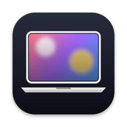
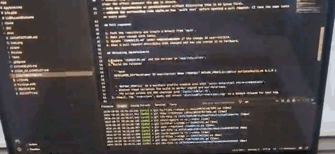

<p align="center">
  
</p>

<h1 align="center">LidBlur</h1>

<p align="center">
  A blur that follows your MacBook's hinge. Close the lid and the screen softly blurs and dims; open it and the blur recedes.
</p>

<p align="center">
  <a href="https://github.com/Pallavrai/LidBlur/actions/workflows/ci.yml"></a>
  <a href="LICENSE"></a>
  
  
</p>

<p align="center">
  
</p>

---

LidBlur is a small menu-bar app for MacBooks. It reads the hinge's lid-angle sensor and draws a blur-and-dim layer over the built-in display that tracks the lid as you move it.

- **Follows the hinge.** The blur grows as the lid closes and recedes as it opens, eased so it never jumps.
- **Stays out of the way.** Hold the lid still and the blur stays. Touch the keyboard or trackpad and it fades out.
- **Built-in display only.** External monitors, mirroring and clamshell mode are never affected.
- **Light.** No network access, no permission prompts, and close to zero CPU while the lid is still.

> LidBlur is a visual effect, not a privacy tool. Don't rely on it to hide what's on your screen.

## Requirements

- A MacBook with Apple silicon and a readable lid-angle sensor. Most recent MacBook Air and MacBook Pro models have one, but Apple doesn't document which. LidBlur checks at launch and tells you if your Mac isn't supported.
- macOS 14 Sonoma or later.

## Install

### Homebrew

LidBlur isn't in Homebrew's main catalog yet, so add this repository as a tap and trust it first:

```bash
brew tap pallavrai/lidblur https://github.com/Pallavrai/LidBlur
```

```bash
brew trust pallavrai/lidblur
```

```bash
brew install --cask lidblur
```

### Download

Download the latest `LidBlur-<version>.dmg` from [Releases](https://github.com/Pallavrai/LidBlur/releases), open it, and drag LidBlur into Applications.

### First launch

Current releases aren't notarized by Apple yet, so macOS blocks the first launch. To allow it:

1. Open LidBlur once and dismiss the warning.
2. Open **System Settings → Privacy & Security**.
3. Scroll to the message about LidBlur and click **Open Anyway**.

You only need to do this once per version.

## Usage

LidBlur lives in the menu bar as a laptop icon.

| Menu item | What it does |
| --- | --- |
| Status line | Shows the current state and the live lid angle. |
| Enabled | Turns the effect on or off. |
| Launch at Login | Starts LidBlur when you log in. |
| Blur starts at | Sets the lid angle where the blur begins (30°–110°, default 80°). |
| Start Blur at Current Lid Angle | Hold the lid where you want the blur to begin, then choose this. |
| Preview Effect | Plays the effect once without moving the lid. |
| Copy Diagnostics | Copies a short report to include in bug reports. |
| About LidBlur | Shows the welcome window. |
| Check for Updates… | Opens the Releases page. |

If the menu-bar icon is hidden, for example behind the notch, open LidBlur again from Applications to show its window.

### How the effect behaves

- **Closing:** the blur and dim grow in step with the lid, from the start angle down to the point where the screen turns off.
- **Holding still:** the blur stays at that angle for as long as you hold it.
- **Typing, moving the cursor, scrolling or clicking:** the blur fades out over about a second. It stays away until you close the lid further.
- **Opening:** the blur recedes with the lid, mirroring the close.

### If the screen stays blurred

Move the cursor or press any key. If that doesn't clear it, press **Control-Option-Command-B**, which quits LidBlur immediately and restores the screen. LidBlur also has two automatic safeguards:

- It fades out a near-full blur after two minutes with no input.
- It quits itself if it ever freezes while the blur is showing.

## Privacy

LidBlur makes no network connections and asks for no permissions. It reads two things:

- the lid angle from the hinge sensor
- how many seconds have passed since your last key press or pointer movement

It never sees which keys you press or where the pointer is.

## Accessibility

- **Reduce Transparency:** LidBlur only dims, with no blur.
- **Reduce Motion:** the effect follows the hinge directly, with no extra smoothing of the angle.

## Known limitations

- **Opening after sleep:** if the lid closes far enough for the Mac to sleep, opening it shows the lock screen first, and apps can't draw over that. The opening effect only appears if you reopen before the Mac sleeps.
- **Screen recordings and screen sharing:** the overlay is excluded from screenshots, recordings and screen sharing.
- **Future macOS versions:** Apple doesn't document the hinge sensor, so a future macOS update could change or block it. If that happens, LidBlur reports the sensor as unsupported and stays out of the way.

## Building from source

Requires Xcode 16 or later.

```bash
swift test
```

```bash
scripts/build.sh
```

`scripts/build.sh` produces `dist/LidBlur.app` and a DMG. See [CONTRIBUTING.md](CONTRIBUTING.md) for development and release details, and [docs/ARCHITECTURE.md](docs/ARCHITECTURE.md) for how the app works.

## Contributing

Bug reports and pull requests are welcome. Please read [CONTRIBUTING.md](CONTRIBUTING.md) and the [Code of Conduct](CODE_OF_CONDUCT.md) first. If LidBlur doesn't support your Mac, open an issue with the output of **Copy Diagnostics**: it helps map which models expose the sensor.

## Acknowledgements

The hinge sensor's HID identifiers and report format were first documented by [LidAngleSensor](https://github.com/samhenrigold/LidAngleSensor) by Sam Henri Gold.

## License

LidBlur is released under the [MIT License](LICENSE).
